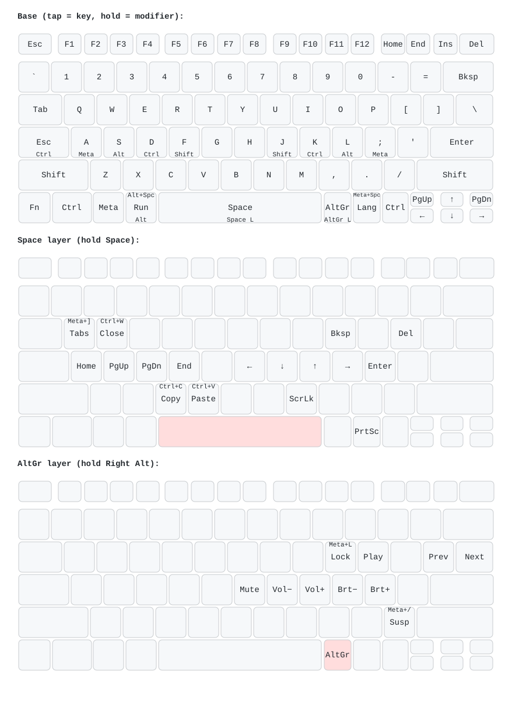

# keyd config

Optimized layout designed to minimize hand movement, reduce wrist strain,
improve ergonomics, and maximize productivity.



*The picture follows the Lenovo ThinkPad T14 Gen 4 (US) keyboard.
Other models may differ slightly.*

## Layers

- **HRM**: Modifiers (Meta, Alt, Ctrl, Shift) are placed directly on the home
  row (ASDF / JKL;) via dual-function keys. Tap for the character, hold for
  the modifier.
- **CapsLock**: Acts as `Ctrl` on hold and `Escape` when tapped
- **Space Layer**: Hold `Space` (200ms+) to access navigation, editing and
  shortcut keys; tap for a regular space. Within 150ms of the previous
  keypress it is always a plain space, so fast typing never triggers the
  layer
- **Left Shift**: Tap for `Alt + Meta`; hold for `Shift`
- **Right Shift**: Tap to change keyboard layout (`Meta + Space`); hold for
  `Shift`
- **Left Alt**: Tap to launch KRunner (`Alt + Space`); hold for `Alt`
- **Right Alt (AltGr)**: Uses `Right Alt` on hold to access media controls and
  system actions

*Note: HRM and Space use custom timeouts. A tap (< 150ms) registers as a
character. Holding (> 200ms) or pressing in combination with another key
registers as the modifier.*

## Space Layer

### Navigation & Editing

- `H`, `J`, `K`, `L` → `Left`, `Down`, `Up`, `Right`
- `A`, `S`, `D`, `F` → `Home`, `Page Up`, `Page Down`, `End`
- `O` → `Backspace`
- `[` → `Delete`
- `;` → `Enter`

### Browser, Tabs, Clipboard

- `Q` → `Meta + ]` (Brave: tab search panel)
- `W` → `Ctrl + W` (close tab)
- `R` → `Ctrl + R` (reload page)
- `T` → `Alt + F4` (terminate window)
- `C`, `V`, `X` → `Ctrl + C`, `Ctrl + V`, `Ctrl + X` (copy, paste, cut)

### Symbols

- `I` → `-` (hyphen)

### System / Misc

- `N` → `ScrollLock` (voice input using voxtype)
- `M`, `,` → scroll down, scroll up (repeats while held)

## RightAlt layer

### System

- `SysRq` → `PrintScreen` (screenshot)
- `O` → `Meta + L` (lock screen)
- `/` → `Meta + /` (suspend)

### Media & Brightness

- `H` → Mute Audio
- `J`, `K` → Volume Down, Volume Up
- `P` → Play/Pause
- `]`, `\` → Previous Song, Next Song
- `L`, `;` → Brightness Down, Brightness Up

## Requirements

- Linux environment
- [keyd](https://github.com/rvaiya/keyd)
- KDE Plasma (for KRunner, lock screen and suspend shortcuts)

## Installation

1. Install `keyd` from the
   [official repository](https://github.com/rvaiya/keyd).
2. Copy config file to `/etc/keyd/default.conf`:

   ```bash
   sudo cp default.conf /etc/keyd/
   ```

3. Reload the `keyd` config:

   ```bash
   sudo keyd reload
   ```

## Regenerating the layout image

`assets/layout.svg` is generated from `default.conf` with
[keymap-drawer](https://github.com/caksoylar/keymap-drawer). After changing
the config, run:

```bash
uv run scripts/draw_layout.py
```

Cursor and Claude Code hooks in this repo do this automatically when an agent
edits `default.conf`. See [AGENTS.md](AGENTS.md) for details.

## TODO

- [x] Add Home, End hotkeys to space_layer
- [x] Add Alt+F4 hotkey to space_layer
- [x] Add PrtScn hotkey to altgr_layer
- [x] Add Cut function to space_layer
- [x] Add Hyphen to space_layer

## License

MIT
